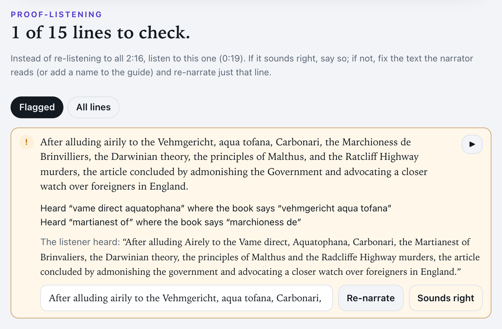
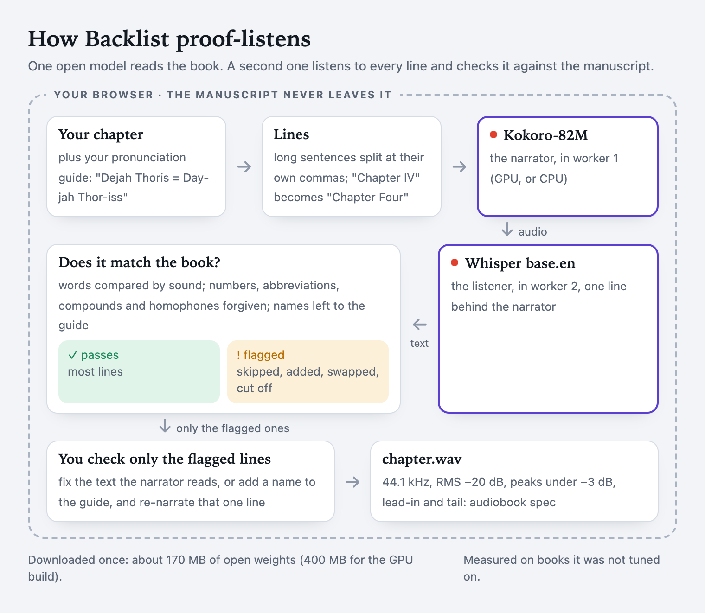

# AuthorVoice Proof

**QA for AI audiobook narration.** Formerly AuthorVoice, and Backlist before that.

Narration is now free or cheap: KDP Virtual Voice, Google Play's auto-narration, ElevenLabs. Checking it is not. The usual advice to an author is to transcribe each chapter and compare it with the manuscript by hand.

AuthorVoice Proof does that check on your own device. Upload the manuscript and the audio from any narration engine. An open speech recogniser listens to every line and you get a list of what to listen to:

- **skipped, added, garbled and mispronounced lines**, each with the file and the time to jump to
- **sentences cut short**, where an engine stopped reading partway (some engines silently drop the end of a long sentence)
- **a pronunciation list** of the book's names and unusual words, how the listener heard each one, and the places where a name sounds unlike its other times
- **audio levels** against what ACX, Google Play and Kobo publish: RMS, peak, noise floor, room tone, sample rate, bitrate and format

The report exports as CSV and as a page to print. Nothing is uploaded.

**Live:** https://vanshajpoonia.github.io/backlist/

The original narrator is still there as an optional extra: [narrate.html](https://vanshajpoonia.github.io/backlist/narrate.html). It narrates a chapter with Kokoro and proof-listens as it goes (see [The narrator](#the-narrator)).

## What goes in

- **Manuscript:** .txt, .md, .docx or .epub, or paste it. Headings like "Chapter 4" or Markdown `#` headings start chapters. EPUB chapters are read in spine order.
- **Audio:** MP3, M4A (or M4B), AAC, WAV or FLAC. One file per chapter, or one long file. Files are checked in name order, so `chapter-2` comes before `chapter-10`. Audio can cover just part of the book. Chapters with no audio are listed, not flagged.

## How it works

```
audio file ──► headers: format, rate, channels, bitrate, CBR?        src/probe.js
     │
     ├──► decode a stretch at a time (WAV read directly,             src/decode.js
     │    MP3 in five-minute stretches, others whole)
     │         │
     │         ├──► levels: RMS, peak, noise floor, room tone        src/levels.js
     │         │
     │         └──► mono 16 kHz, cut at pauses into 12-25 s pieces   src/segment.js
     │                   │
     │                   ▼
     │              Whisper base.en hears each piece                 src/listen.js, src/worker.js
     │                   │
manuscript ──► lines ──► line the heard words up with the book       src/align.js
                         (unique word triples as anchors, then the
                          checker's sound-alike alignment between)
                                   │
                                   ▼
                each line gets its slice, the checker's rules         src/compare.js
                decide, sentences that stop early are marked,         src/proof.js
                names are compared with their other occurrences       src/names.js
                                   │
                                   ▼
                        report, CSV, printable page                   src/report.js
```

- **The checker is the one measured below on Kokoro**, unchanged: `src/compare.js` aligns the book's words with what was heard and forgives what is the listener's fault rather than the narrator's (numbers written as digits, "Mr." for "mister", British and American spelling, compounds, homophones, and names it has never heard). What it does not forgive: skipped words, added or repeated words, a word swapped for another, a line cut short. For a whole file, the transcript is first lined up with the whole manuscript (`src/align.js`), then each line is judged on its own slice.
- **Labels:** *skipped* means words were missing. *Added* means extra or repeated words. *Mispronounced* means one or two words were heard as other words, and *garbled* means three or more. *Cut short* means a sentence's last words (three or more, and at least a sixth of it) were never said.
- **Names:** the listener cannot spell a name it has never heard ("Dejah Thoris" comes back as "Digiothorus"), so a name is never flagged for being spelled oddly. Instead each occurrence is compared with the book's other occurrences of that name, by consonant outline, and one that sounds unlike all the others is flagged.
- **Levels** are measured the way Audacity's ACX Check plugin measures them: RMS and peak over the whole file, the noise floor as the RMS of the quietest half second. Each retailer's numbers and sources are below.

## Measured

Every number here comes from a script in `tests/`, and each says what it ran on. The listener is Whisper base.en, 8-bit, the build the page runs.

### On a second engine, whole files (macOS `say`)

`npm run eval:engines` takes the same 80 held-out test lines and planted faults as the Kokoro evaluation below (40 from *A Study in Scarlet*, 40 from *A Princess of Mars*), but has macOS `say` speak them, in four voices: Samantha (American), Daniel (British), Karen (Australian) and Moira (Irish). It gives `say` the text as written, the way an author would give it to any engine. The lines are joined into two files, one per book, and go through the whole pipeline the page runs: cut into pieces, heard, lined up with the manuscript, judged line by line. There is one clean set of files and four with faults, where every line long enough carries one fault, a different one each time. A fault only counts as caught if its own line is flagged.

The checker is the one frozen on Kokoro, and the whole-file steps were written before this run, so the fault and false alarm numbers are held out. The time row is not: the way word times are shared out inside a piece (by letters rather than by word count, which was 0.2 s median and 1.1 s at 90%) was chosen on these same clean files.

Run twice. `say` does not render every line identically each time, so the second run heard 29 pieces afresh.

| | Result |
|---|---|
| False alarms on the clean files | 5/80 (6%), then 6/80 (8%) |
| Clean lines next to faults, flagged | 0/24 |
| Skipped | 74/74 |
| Repeated | 72/74 |
| Swapped | 74/74 |
| Cut off | 74/74 |
| **All faults, on their own line** | **294/296 (99%)**, both runs |
| Labelled with the right kind | 290/294 |
| Reported line time vs where the line really starts | median 0.1 s, 90% within 0.7 s, worst 1.3 s, then 1.4 s |

Both misses are repeats, the listener's known blind spot: Whisper wrote "of Medicine of Medicine" down once. The false alarms are the listener mishearing `say`, not `say` getting the words wrong. The first run's five: "air" as "heir", "on Mars" as "en masse", "captor" as "character", "honours and" as "on as an", "die violent" as "dive island". That is a higher false alarm rate than on Kokoro (1/80 held out), so expect to dismiss a few flags by ear on a robotic voice.

The play buttons start 1.5 seconds before the reported time, to cover the worst case above.

### Sentences cut short

`npm run eval:cutoff` finds every sentence in the three test books over Kokoro's 510-token limit, counted with Kokoro's own phoneme code: 16 of them, rejoined whole from the manuscript reader's lines. Kokoro reads each one in a single go, so it really drops the end, and `say` reads each one in full as the control. Each set is one file through the whole pipeline.

| | Kokoro, unsplit (ends really dropped) | `say`, in full |
|---|---|---|
| Labelled cut short | 14/16 | 0/16 |
| Flagged for anything | 15/16 | 2/16 |

In the other two Kokoro sentences the listener heard the sentence to its end, so no audible ending was lost (one has a single word missed in the middle). The two `say` flags are the listener mishearing a word, not a cut.

This is not a held-out number. The first run, with the rules as first written, flagged 16 of 17 sentences (it also counted a contents page as a sentence) but labelled only 5 *cut short*. The rule then also asked for at least a sixth of the sentence to be missing, which a long sentence cut at Kokoro's limit often is not (9 to 20 words of about 100), and one word matched by chance inside the unsaid end broke it. Both were fixed and the eval run again.

The manuscript side also lists every sentence over 50 words in the report, since that is where engines with a length limit stop early.

### Names said differently in one place

`npm run eval:names` takes eight invented names from *A Princess of Mars* (Tal Hajus, Kantos Kan, Lorquas Ptomel, Woola, Zodanga, Kosis, Tardos Mors, Sarkoja), five short lines for each, spoken by `say` in two voices. In one rendering every name is said as written. In two more, one occurrence of each name is changed, by one consonant ("Salkoja") or by two ("Salpoja"), standing in for an engine that guesses a name differently in one chapter. The check was written before this eval was run.

| | Flagged |
|---|---|
| One consonant changed | 3/16 (19%) |
| Two consonants changed | 10/16 (63%) |
| Names said as written (false alarms) | 18/316 (6%) |

This is a hint, not a verdict. The listener spells a name it has never heard a different way almost every time (from one voice, "Kosis" came back as "khaasas", "kausus" and "cautious"), so a small change hides in that noise. Some false alarms come from the listener fusing a name with the word before it ("and Kosis" as "ancosis"). The pronunciation list is still worth a scan: it shows every way each name was heard, with a play button for the odd ones.

### The demo narration

`npm run eval:sample` runs the page's pipeline on `data/samples/mars-narrated.mp3`, Kokoro reading chapter XI of *A Princess of Mars* with four planted mistakes: a skipped phrase, read-out quote marks, a misread word and a sentence that stops early. The report lists all four with the right labels and nothing else. Its first version planted "rupture" for "rapture", and the checker let it through: see the limits below.

### On Kokoro, line by line

This is the measurement the checker was built and frozen on, with the built-in narrator. Each line was rendered and heard on its own, not as part of a file.

`npm test` renders real book lines through the real models and plants faults in the text the narrator reads: three words skipped, three words said twice, one word swapped for another, and the last 40% of the line never said. A good proof-listener catches the faults and stays quiet on clean audio. Lines rotate through four voices, two American and two British.

The checker's rules were tuned on 30 lines of *A Christmas Carol*, then frozen and tested on lines it had never seen, from *A Study in Scarlet* and *A Princess of Mars*.

**Test set** (80 lines with faults planted, plus 19 more lines the narration rules change and 12 chapter headings):

| Checker | False alarms on clean audio | Skipped | Repeated | Swapped | Cut off | All faults |
|---|---|---|---|---|---|---|
| Exact match after normalising | 25/80 (31%) | 74/74 | 68/74 | 74/74 | 74/74 | 98% |
| Word error rate ≤ 15% | 1/80 (1%) | 27/74 | 24/74 | 5/74 | 74/74 | 44% |
| **The checker, rules frozen before the test** | **1/80 (1%)** | **74/74** | **67/74** | **72/74** | **74/74** | **97%** |
| The checker after fixing what the test exposed | 0/80 | 74/74 | 67/74 | 74/74 | 74/74 | 98% |

The exact-match checker catches everything and cries wolf on almost a third of perfectly good lines. The usual word-error-rate threshold is quiet, but misses more than half the faults, including all but 5 of 74 swapped words: one wrong word in a long sentence is under 15%. The checker is as quiet as the threshold and as thorough as exact match.

The frozen run is the honest held-out number. It also exposed three gaps, now fixed: a word only counts as a name if the book never writes it in lower case (a title-case table of contents had made "Through" a name, and "Mountains" was one because of "the Rocky Mountains"); a word the listener splits in two ("Decameron" as "de Cameron"); and the homophone "corps"/"core". The last row is after those fixes, so it is no longer a held-out number. **Every fault still missed is a repetition**: three words said twice, which the listener wrote down once (more on that below).

**Narration rules:** of the 31 test lines the rules change, the listener flagged 6 rendered as written and 1 rendered with the rules. Five of the six were chapter headings ("Chapter Roman 2", "Chapter Romans 3, my Advent on Mark"), all fixed. The one left is *"bade adieu to their landlady upon Tuesday, the 4th inst."*, heard as "bated due ... the fourth inced" either way: archaic and French words are what the pronunciation guide is for. The other rules (Saint or Street, military titles, symbols) never changed a verdict in these books; they are cheap insurance, not a measured fix.

Tuning set (*A Christmas Carol*, 30 lines):

| Checker | False alarms on clean audio | Skipped | Repeated | Swapped | Cut off |
|---|---|---|---|---|---|
| Exact match after normalising | 12/30 (40%) | 21/21 | 20/21 | 21/21 | 21/21 |
| Word error rate ≤ 15% | 2/30 (7%) | 17/21 | 17/21 | 4/21 | 21/21 |
| **The checker** | **1/30 (3%)** | **21/21** | **20/21** | **21/21** | **21/21** |

The repeat it misses is a real limit of the listener, not the rules: Kokoro said "to the point to the point" and Whisper wrote it down once. Whisper was trained on tidied-up transcripts and quietly removes repetitions. The test set confirmed it: all seven faults the checker misses there are repetitions.

Two rules were added after the tuning run, from trying the app on a chapter of *A Princess of Mars* outside the test lines: a respelled name ("Sar-koh-ja") comes back as several words, and a split name ("Tar's Tar Cuss") can leave a stray piece beside it. Neither changed the tuning numbers above.

### Limits

- **A word that differs only in its vowels passes**, and so does a one-letter change in the consonants of a word of four letters or more ("rupture" for "rapture", "capture" for "rapture"). The checker compares words by their consonant outline so that it forgives the listener's spelling of names, and that rule applies to every word. A unit test records it.
- **Repeats are the listener's blind spot.** Whisper tends to write a stutter down once.
- **Names are judged only against each other.** The listener cannot tell a right pronunciation of a name it has never heard from a wrong one, only one occurrence from another.
- **It hears words, not performance**: pacing, tone, a wrong emphasis or a mispronunciation that still sounds like the word all pass.
- **Long M4A files are decoded whole** by the browser, so one of several hours may not fit in memory. MP3 and WAV are decoded in stretches and work at any length.

## Retailer specs

Checked on 20 November 2026. Stores change their rules, so check before you upload.

| | ACX (Audible) | Google Play Books | Kobo |
|---|---|---|---|
| Format | MP3 | MP3, M4A, AAC, FLAC, WAV | MP3 |
| Bitrate | 192 kbps or more, constant | 128 kbps mono, 256 kbps stereo (constant preferred). FLAC or WAV 16-bit | 192 kbps or more recommended (re-encoded to 64 kbps) |
| Sample rate | 44.1 kHz | 44.1 kHz or more for FLAC and WAV | not stated |
| RMS | -23 to -18 dB | not stated | not stated |
| Peak | -3 dB or lower | not stated | not stated |
| Noise floor | -60 dB or lower | not stated | not stated |
| Room tone | 0.5 to 1 s at the start, 1 to 5 s at the end | not stated | not stated |
| Per file | one chapter, header read aloud, at most 120 minutes. All mono or all stereo, not joint stereo | book of 5 minutes to 100 hours | at most 1,500 files |
| AI narration | not accepted (human narration only) | accepted as a "Synthesized voice" narrator | accepted, disclosed as a synthesized voice |

Sources: [ACX audio submission requirements](https://www.acx.com/help/article/acx-audio-submission-requirements), [Google Play Books file guidelines](https://support.google.com/books/partner/answer/3424254), [Kobo audio operations guide](https://kobocontentoperations.zendesk.com/hc/en-us/articles/4410661407003-Audio-Operations-Guide), and Audacity's [loudness checks](https://plugins.audacityteam.org/analyzers/loudness-compliance-checks) for how ACX Check measures. ACX's file spec is the strictest, and pure digital silence between lines (which many engines produce) reads as a warning: ACX asks for room tone.

## Run it

```bash
npm start                 # static server on :8000, no build step
npm install               # only for the tests
npm test                  # unit checks, then the Kokoro proof-listening evaluation
npm run eval:engines      # whole files from macOS say (macOS only)
npm run eval:cutoff       # sentences Kokoro cuts short, against say reading them in full
npm run eval:names        # names said differently in one place (macOS only)
npm run eval:sample       # the demo narration's report finds its four planted mistakes (macOS only)
node scripts/sample.mjs   # re-render the demo narration (needs lame)
```

The evals cache every rendering and transcript in `tests/.cache`, so a second run takes a minute.

## Files

```
src/proof-app.js    the Proof page
src/probe.js        audio file headers: WAV, MP3, M4A, AAC, FLAC
src/decode.js       audio to samples in the browser, a stretch at a time
src/levels.js       levels and the retailer specs
src/segment.js      16 kHz mono, cut at pauses into pieces for the listener
src/align.js        a whole file's transcript against the whole manuscript
src/proof.js        per-line verdicts, sentences cut short, chapters with no audio
src/names.js        the pronunciation list
src/report.js       report rows, CSV, the printable page
src/ebook.js        EPUB and Markdown manuscripts
src/manuscript.js   chapters, headings, scene breaks, sentences, splitting long ones
src/compare.js      the checker
src/listen.js       Whisper
src/worker.js       one model per Web Worker
src/isolate.js      service worker and cross-origin isolation
narrate.html, src/app.js, src/narrate.js, src/voice.js, src/audio.js, src/words.js   the narrator
tests/unit.mjs      fast checks, no model
tests/proof.mjs     the Kokoro evaluation, line by line
tests/engines.mjs   whole files from another engine
tests/cutoff.mjs    sentences cut short
tests/names.mjs     names said differently
tests/sample.mjs    the demo narration's report
tests/evalkit.mjs   rendering with say, joining lines into files, a cached listener
tests/faults.mjs    the faults the evals plant
tests/fixtures/     one-second audio files from lame, afconvert and ffmpeg, and a tiny EPUB
```

## The narrator

Paste a chapter at [narrate.html](https://vanshajpoonia.github.io/backlist/narrate.html). **Kokoro**, an open-weight voice model, narrates it in your browser. **Whisper** listens to every line one line behind and checks it against the manuscript. You re-check the handful of lines it flags (accept them by ear, or fix the text and re-narrate just that line) and download a file mastered to audiobook spec.



### Why a second model

A human-narrated audiobook costs an indie author $200 to $400 per finished hour, so a ten-hour novel is $2,000 to $4,000. An author with fifteen books in their backlist does not have that, which is why most backlists are never narrated. Text-to-speech fixes the cost. It does not fix the other half of audiobook production: **proof-listening**, where someone hears every minute against the manuscript to catch skipped words, misread words and garbled lines. That is a paid human job too, and nobody wants to sit through ten hours of a voice model to find the six lines it got wrong.

So the narrator uses a second open model as the proofer. It cannot judge performance, but it can hear when the words are wrong, and that turns out to be most of what goes wrong.

### How the narrator works



```
manuscript ──► chapters ──► lines (<= 50 words) ──► narration rules + your pronunciation guide
                 src/manuscript.js                      src/narrate.js
                                                              │
                     ┌────────────────────────────────────────┘
                     ▼
   worker 1: Kokoro-82M ──audio──► worker 2: Whisper base.en ──text──► does it match the book?
   (GPU, or CPU q8)                (CPU, q8)                            src/compare.js
                     │                                                   │            │
                     ▼                                                  ok        flagged: you listen,
              src/audio.js: trim, pauses, 44.1 kHz, RMS -20 dB,                    fix the text, re-narrate
              peaks under -3 dB, lead-in and tail ──► chapter.wav                  that one line
```

- **Two models, two Web Workers, one runtime.** Both run on [transformers.js](https://github.com/huggingface/transformers.js). The narrator works ahead and the listener follows one line behind, so checking costs almost no extra time.
- **The narrator's text handling** is a readable port of [kokoro-js](https://github.com/hexgrad/kokoro/tree/main/kokoro.js) (`src/voice.js`): Kokoro's own normalisation, then eSpeak NG phonemes, then the model, so the browser and the test suite run identical code.
- **The checker** (`src/compare.js`) aligns the book's words with what was heard and forgives what is the listener's fault rather than the narrator's: numbers written as digits, "Mr." for "mister", British vs American spelling, compounds ("door-nail" heard as "doornail"), homophones ("won" heard as "one"), and names it has never heard ("Dejah Thoris" comes back as "Digiothorus"). What it does not forgive: skipped words, added or repeated words, a word swapped for a different one, a line cut short.
- **Mastering** (`src/audio.js`) trims Kokoro's own silences, adds consistent pauses (sentence, paragraph, scene break), resamples to 44.1 kHz with a windowed-sinc filter, sets the RMS to -20 dB and holds peaks under -3 dB with a limiter: the spec most audiobook distributors publish.

### What the proof-listener found in Kokoro

Things the listener caught while building this, each now handled in `src/narrate.js` or `src/manuscript.js`:

- **Roman numerals are read as "Roman".** Kokoro reads *Chapter IV* as "Chapter Roman four" and *Henry VIII* as "Henry Roman eight". Book headings get cardinals ("Chapter Four"), monarchs get ordinals ("Henry the Eighth").
- **Long sentences are cut off without warning.** Kokoro reads at most 510 phoneme tokens at a time and silently drops the rest. Counted with Kokoro's own phoneme code on the text of the three test books, **17 sentences** are over that limit (an earlier count of 21 included six sentences of the Project Gutenberg licence and counted phonemes slightly differently). The longest, in *A Princess of Mars*, is 168 words (1,317 tokens), so more than half of it would simply never be said. The narrator splits sentences over 50 words at their own commas and semicolons, and re-splits any line that still comes close.

### Narrator speed

Narrating, proof-listening and mastering the *A Princess of Mars* sample (3 minutes 21 seconds of audio) in Chrome on an Apple M4:

| | Time | Speed |
|---|---|---|
| Narrator on the GPU, page cross-origin isolated (the live site) | 0:44 | 4.5x real time |
| Narrator on the GPU, not isolated | 1:34 | 2.1x real time |
| No GPU at all (both models on the CPU) | 4:51 | 0.7x real time |

On the GPU every line of that chapter passes. The CPU build of the narrator is 8-bit, and with it one line is flagged: *"there are but ten chieftains"*, heard as "about 10". That changes the meaning, so it is worth the ten seconds it takes to listen.

The listener always runs on the CPU, and it is only quick when the page is cross-origin isolated, which lets ONNX Runtime use several threads. GitHub Pages cannot send the headers for that, so the service worker (`sw.js`) adds them to every file it serves and the page reloads itself once on the first visit. On a host that can send headers, `vercel.json` does the same job.

### Before you publish

Stores differ and their rules change. At the time of writing, Audible's ACX requires human narration, while Google Play Books has a "Synthesized voice" narrator type in its Partner Center and Kobo Writing Life accepts digitally narrated audiobooks if you say so in the description. Selling direct (your own site, Bookfunnel, a Kickstarter reward) has no such rules. Check your distributor before uploading.

## Credits

Listening: [Whisper](https://github.com/openai/whisper) by OpenAI (MIT), [ONNX build](https://huggingface.co/onnx-community/whisper-base.en). Narration: [Kokoro-82M](https://huggingface.co/hexgrad/Kokoro-82M) by hexgrad (Apache-2.0), [ONNX build](https://huggingface.co/onnx-community/Kokoro-82M-v1.0-ONNX). Text handling ported from kokoro-js (Apache-2.0). Phonemes: [phonemizer.js](https://github.com/xenova/phonemizer.js) (Apache-2.0), built on eSpeak NG (GPL-3.0), loaded at runtime. .docx reading: [mammoth](https://github.com/mwilliamson/mammoth.js) (BSD-2-Clause), loaded at runtime. Runtime: transformers.js and ONNX Runtime Web. Sample and test texts are public domain, via Project Gutenberg. The demo narration (`data/samples/mars-narrated.mp3`) is Kokoro reading chapter XI of *A Princess of Mars*.

Code: MIT licence.
